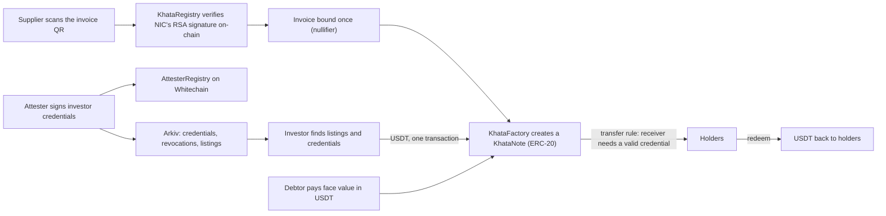

# Khata

**Invoice financing for small Indian suppliers, settled in USDT on Whitechain.**

India's tax network signs every B2B e-invoice, and the signed data is in the invoice's QR code. A Khata contract checks that signature on-chain, refuses to finance the same invoice twice, and turns each invoice into an ERC-20 note that only credentialed investors can hold. Investors pay in USDT, and the money goes straight to the supplier in the same transaction.

**Live app:** [khata-theta-ten.vercel.app](https://khata-theta-ten.vercel.app/). It reads straight from Whitechain Sepolia and Arkiv Rabdi, through Anon-RPC by default. Built solo for [ETHGlobal Mumbai 2026](https://ethglobal.com/events/mumbai) (5 to 7 November 2026).

All code in this repository was written during the hackathon, and the commit history shows the work from the first evening onward. The open-source libraries I used are listed under [Stack](#stack).

Every wallet in the app is a labelled demo wallet, and the full lifecycle runs on invoices signed with a labelled "DEMO IRP (not government)" key. [What is real and what is a demo](#what-is-real-and-what-is-a-demo) says exactly what that means.

---

## The problem

A small supplier sells goods on credit and waits 60 to 90 days to be paid. An investor would advance the cash for a fee, but has two fears: the invoice is fake or edited, or the same invoice was sold to someone else. Khata answers both on-chain.

## How it works



1. The supplier scans the QR (camera or pasted text). The page shows what was checked: the NIC header, the key id, whether the key matched, the invoice number and the IRN.
2. `KhataRegistry` verifies the RS256 signature with OpenZeppelin's `RSA.pkcs1Sha256`, parses the payload, and binds the invoice's nullifier exactly once. A second attempt reverts with `IrnAlreadyFinanced`, and a changed byte reverts with `InvalidSignature`.
3. Only the seller's own wallet can bind the invoice. An attester signs a binding between the seller's GSTIN and the seller's wallet, so someone who photographs another supplier's QR cannot register it first (`NotSellerWallet`).
4. `KhataFactory` creates a `KhataNote` for the invoice. Funding opens after a cool-off set when the registry is deployed. The intended value is 24 hours, because an e-invoice can be cancelled within 24 hours and its signature still verifies, and the unit tests use 24 hours. The live deployment uses 60 seconds so a lifecycle fits in a few minutes.
5. An investor funds the note in USDT at a discount. Payment and delivery of the notes happen in one transaction, and the supplier receives the USDT at once.
6. Notes move between holders only if the receiver has a valid credential: signed by an accepted attester, not expired, not revoked, and at or above the note's minimum tier. There are no transfers after maturity.
7. The debtor pays the face value on or after the due date and holders redeem. If nobody pays by the due date plus a grace period, anyone can mark the note defaulted.

Credentials are EIP-712 messages signed by an attester. They are published on Arkiv as expiring entities so any lender can find them, and registered on Whitechain, where the note contract enforces them. Whitechain contracts cannot read Arkiv, so Arkiv is for discovery and Whitechain is where the rule is enforced. A revocation is an attester-signed message that anyone can submit to Whitechain.

---

## Why Whitechain

The two frauds an investor fears are both about shared state. Whether an invoice was financed once only matters if every investor reads the same answer, and being paid only matters if the payment and the transfer of the claim can't be separated. The registry holds the first. The funding transaction handles the second: USDT moves to the seller and the notes move to the investor in one atomic call, so nobody is paid unless the other side delivers. Holders redeem from a contract that holds exactly what the debtor paid, and the live suite checks that a finished note ends with 0 USDT and 0 notes left in it.

A regular payment rail, such as a bank transfer or UPI, can move the money, but it can't tie the payment to the delivery of the claim, and it gives investors no shared record that an invoice was financed only once unless they trust the platform running the database. Here the note and the USDT change hands in one transaction, and anyone can read the registry to see that an invoice is spent.

The chain also has to be cheap enough to do the heavy part on-chain. Verifying a 2048-bit RSA signature, parsing the JSON payload and writing state costs about 1.12M gas for `bindInvoice`, around 0.006 WBT at Whitechain's roughly 5 gwei. Blocks come about once a second, so a full lifecycle runs in minutes.

The honest gap: nothing in the note logic is specific to Whitechain, and it could run on any EVM chain with the modexp precompile. What I used from Whitechain is the chain itself, the Tokenize prize's USDT as the settlement asset, and a fast, cheap testnet to test against all night.

## Whitechain features used

| Feature                                | How it's used                                                                                                                                    |
| -------------------------------------- | ------------------------------------------------------------------------------------------------------------------------------------------------ |
| Whitechain Sepolia (chain 1874)        | Four contracts deployed and verified on the explorer; every refusal in the table below is a mined transaction                                    |
| Prize USDT (`0xcedf…55a7`, 6 decimals) | The settlement asset for funding, settlement and redemption. Its EIP-2612 permit powers `fundWithPermit`, so approve and fund is one transaction |
| Modexp precompile                      | `RSA.pkcs1Sha256` verifies NIC's signature; a direct verify costs about 49.5k gas                                                                |
| Blockscout verification                | `forge script --verify --verifier blockscout` verified all four contracts                                                                        |
| Uniswap V3 pool (WWBT/USDT)            | `scripts/swap-usdt.mjs` turns WBT into the prize USDT for the demo wallets (0.12 WBT became 8.82 USDT in one swap)                               |
| JSON-RPC batching                      | Many reads per request, which matters over Tor                                                                                                   |

---

## Why Arkiv

Credentials, listings and revocations are data that several parties need to read and none of them should have to ask me for. An attester signs "this wallet may hold notes" and publishes it. A second lender who has never heard of Khata can read that credential and check it with nothing but the public schema, the AttesterRegistry address and an RPC. `npx tsx scripts/second-issuer.ts <wallet>` does exactly that and accepts an investor from the attester's Arkiv credentials alone.

Each entity is owned by the wallet that wrote it, so a credential belongs to the attester and a listing to the supplier, and Arkiv rejects edits from anyone else. Expiry does the cleanup: a credential, a listing and an attester heartbeat all stop existing when they should, with no job and no "last seen" column. The attester desk shows "running" or "silent" from a heartbeat entity that lives 600 seconds.

The honest gap: Whitechain contracts cannot read Arkiv, so Arkiv cannot enforce anything. The note contract re-checks every credential's signature, expiry and revocation itself. If Arkiv were down, transfers, settlement and redemption would still work; what breaks is discovery. Arkiv's expiry is also block based and approximate, so it is never used as a security boundary.

The full write-up is in [`arkiv/`](arkiv): [`schema.md`](arkiv/schema.md), [`how-you-use-arkiv.md`](arkiv/how-you-use-arkiv.md), [`why-arkiv.md`](arkiv/why-arkiv.md), [`reach.md`](arkiv/reach.md) and [`friction.md`](arkiv/friction.md).

## Arkiv features used

| Feature                        | How it's used                                                                                                              |
| ------------------------------ | -------------------------------------------------------------------------------------------------------------------------- |
| Typed schemas (`defineSchema`) | Four entity types: `khata.credential`, `khata.revocation`, `khata.listing`, `khata.heartbeat`                              |
| Entity ownership               | Only the writing wallet can update, extend or delete an entity; tested for all three from a non-owner wallet               |
| Expiry (`ExpirationTime`)      | Credentials expire at `validUntil`, listings at due date plus grace plus an hour, heartbeats after 600 s                   |
| Query builder                  | Investor credential lookup; marketplace filters (status, minimum discount, due within) and sorting by due date or discount |
| `patchEntity`, `extendEntity`  | A supplier closes a listing or extends it while the debtor is in the grace period                                          |
| `$key` ordered paging          | Reads every credential without gaps or repeats when a write lands between pages                                            |
| `watchEntityEvents`            | Credentials and marketplace refresh within about a second of a new entity                                                  |

**Wallets that wrote entities:**

- Attester (demo), credentials, revocations and heartbeats: [`0xB288ae1aaAeB761520D4A72bb87DbB6ef11126Db`](https://rabdi.explorer.arkiv.network/address/0xB288ae1aaAeB761520D4A72bb87DbB6ef11126Db)
- Supplier (demo), listings: [`0xa03d3c24469DD58EAE3AE230781f293850A7686b`](https://rabdi.explorer.arkiv.network/address/0xa03d3c24469DD58EAE3AE230781f293850A7686b)

**A query you can run** (all listings written by the supplier wallet):

```bash
curl -s https://rpc.rabdi.db-chain.testnet.arkiv.network -H 'content-type: application/json' \
  -d '{"jsonrpc":"2.0","id":1,"method":"arkiv_query","params":["seller = addr(0xa03d3c24469DD58EAE3AE230781f293850A7686b)",{"limit":5,"select":{"key":true,"owner":true,"attributes":true}}]}'
```

To count every live Khata entity by type and writer: `npx tsx scripts/arkiv-reach.ts`.

---

## Why Anon-RPC

An RPC provider sees every read: which wallet is asking, from which IP address, about which invoice. For an investor looking at invoices that is a map of who is interested in whom. Reads of Whitechain and Arkiv in Khata go through EF's Anon-RPC by default, so a provider cannot link a visitor's IP address to what they look at. One exception, found while recording the demo: when Tor cannot start and the page falls back to Nym, Arkiv's gateway rejects requests that arrive over Nym (HTTP 415, "Content-Type: application/json is required"), so on Nym the Arkiv reads go directly and are counted as direct. Over Tor every read of both chains goes through the route.

The page lets you check this. A chip shows the share of traffic that went through the route, a log lists every read and the route it took, and a Privacy page fetches your visible IP address both directly and through the route and shows the two side by side.

The honest gap: writes are not anonymized. A signed transaction is broadcast directly to the Whitechain RPC and counted as such. Two things also sit outside the route and are listed in the traffic tooltip: one read of the worker specifier from Ethereum mainnet (publicnode), and the harness's WASM file from `cdn.jsdelivr.net`. Neither carries user data, but both see the visitor's IP address. Tor's cold start takes 8 to 17 seconds, and EF's demo gateway says it may disappear at any time. I did not self-host a gateway.

I left some traffic out of the route on purpose. Signed transactions go directly because the RPC has to receive them from the sender, and the mainnet read and the WASM file are needed before the route can exist. Everything else goes through the route: all reads of both chains over Tor, and the Whitechain reads over Nym. The chip shows the share, and on Nym it is below 100% because of the Arkiv exception above.

What it would take to ship: a self-hosted gateway in place of EF's demo gateway, and users' own wallets in place of the demo wallets. Neither is done.

## Anon-RPC features used

| Feature                                | How it's used                                                                                                                                                                                   |
| -------------------------------------- | ----------------------------------------------------------------------------------------------------------------------------------------------------------------------------------------------- |
| `@anon-rpc/browser-harness` 0.4.0, Tor | The default route, with a 25 second start deadline                                                                                                                                              |
| Nym                                    | The fallback. If Tor does not start, the page switches and says why                                                                                                                             |
| `fetchFn` hook                         | `http(url, { fetchFn: worker.fetch })` for viem, and the same transport for the Arkiv SDK, so both chains share one route                                                                       |
| Route self-test                        | The page calls the route ready only after a real test read comes back; a route that boots but cannot answer counts as failed. Nym gets one restart (a new exit) before the page reports failure |
| No silent fallback                     | If neither route starts, the page says so and waits for Retry or an explicit "read directly", which is labelled as not anonymous                                                                |
| Traffic meter and read log             | Share of reads by route, plus direct, broadcast and bootstrap counts                                                                                                                            |
| Privacy page                           | Compares the IP address an echo service sees directly and through the route                                                                                                                     |

---

## Live on testnet

All four contracts are verified on the Whitechain explorer.

| Contract                           | Chain                     | Address                                                                                                                                   |
| ---------------------------------- | ------------------------- | ----------------------------------------------------------------------------------------------------------------------------------------- |
| AttesterRegistry                   | Whitechain Sepolia (1874) | [`0xf189C5c3Cbbe492C87001080e4D1D4ff80d0D57c`](https://explorer.testnet.whitechain.io/address/0xf189C5c3Cbbe492C87001080e4D1D4ff80d0D57c) |
| KhataRegistry                      | Whitechain Sepolia        | [`0x815273B42AAa86Ba02f66313F2AB4961e5146400`](https://explorer.testnet.whitechain.io/address/0x815273B42AAa86Ba02f66313F2AB4961e5146400) |
| KhataFactory                       | Whitechain Sepolia        | [`0x0109104CAEF5aE82ecF6A6d9e4B09918F0b08480`](https://explorer.testnet.whitechain.io/address/0x0109104CAEF5aE82ecF6A6d9e4B09918F0b08480) |
| HonkVerifier (zero-knowledge path) | Whitechain Sepolia        | [`0xADC52A74d0693Aaf047677A47A786a415D595Fa3`](https://explorer.testnet.whitechain.io/address/0xADC52A74d0693Aaf047677A47A786a415D595Fa3) |
| USDT (prize token, not mine)       | Whitechain Sepolia        | [`0xcedfB56113143d55b2358b8CFbB0dEB5Ad2f55a7`](https://explorer.testnet.whitechain.io/address/0xcedfB56113143d55b2358b8CFbB0dEB5Ad2f55a7) |

Earlier deployments are listed as superseded in `deployments/whitechain-sepolia.json`. Notes created by the factory are separate contracts and are not individually verified on the explorer.

### Transactions that show each requirement

Successes and refusals are both on-chain. A refused transaction is mined with an explicit gas limit so the refusal itself is visible.

| What it shows                                           | Result                           | Transaction                                                                                                                        |
| ------------------------------------------------------- | -------------------------------- | ---------------------------------------------------------------------------------------------------------------------------------- |
| NIC's real sample QR bound                              | success                          | [`0xb4bbf155…573c`](https://explorer.testnet.whitechain.io/tx/0xb4bbf155b383bae7ab0e0ea23e0210e7c30b69f31700ad3fc33ce624bb6a573c)  |
| The same sample scanned again as a second financier     | refused, `IrnAlreadyFinanced`    | [`0xa32e9df9…7ce6`](https://explorer.testnet.whitechain.io/tx/0xa32e9df92a673013ab619ee180bf59c672f151c32e54dfb863edb8efc7377ce6)  |
| The sample with one byte changed                        | refused, `InvalidSignature`      | [`0x4c08cbc8…3eff`](https://explorer.testnet.whitechain.io/tx/0x4c08cbc8998a3abcb61a2afe3850c9cdefacc0ac1aab5565b5aca99a57b83eff)  |
| Demo invoice bound                                      | success                          | [`0x168da51f…0ec3`](https://explorer.testnet.whitechain.io/tx/0x168da51f67907ee99f2fda085838b3bb16c35bb626d49b8cb6790fe44f1f0ec3)  |
| Second financing of the same invoice                    | refused, `IrnAlreadyFinanced`    | [`0xcaed92ad…bbad`](https://explorer.testnet.whitechain.io/tx/0xcaed92ade9d235a34e8ffefb22f877de5ffe38c23b1260bc4fba056b8f86bbad)  |
| Note created                                            | success                          | [`0x2e3b1c3d…c20f`](https://explorer.testnet.whitechain.io/tx/0x2e3b1c3d4371d4206a5d4816ca2a67c24714d27ec0e46e3c6d78b3bfb863c20f)  |
| Funding inside the cool-off                             | refused, `CoolOffActive`         | [`0xb8d7edac…2b95f`](https://explorer.testnet.whitechain.io/tx/0xb8d7edacb964370b694a33d8a647be9223bbd875055bc9e5c9c61e09b3a2b95f) |
| Investor funds 3.0 USDT of notes (real USDT settlement) | success                          | [`0x9056c887…2521`](https://explorer.testnet.whitechain.io/tx/0x9056c887df5687f47f851fb2f0168aa9372430e3f48e102334c3bebeb0702521)  |
| Transfer to a wallet with no credential                 | refused, `ReceiverNotEligible`   | [`0x4655e810…8570`](https://explorer.testnet.whitechain.io/tx/0x4655e810c8f02d919bf9e577c314bee66a1cd903dc68f741f309648c18ea8570)  |
| Transfer after the receiver's credential was revoked    | refused, `ReceiverNotEligible`   | [`0x2cbb996b…d8df`](https://explorer.testnet.whitechain.io/tx/0x2cbb996bd87eecbc3f2767cea587bab6f7644e447015dced55077bb76ba4d8df)  |
| Transfer at maturity                                    | refused, `TransferAfterMaturity` | [`0x4f80a9b8…5bde`](https://explorer.testnet.whitechain.io/tx/0x4f80a9b83cb932c4978ecfc2dbc8aa37c4deaf30215c4a63f66f8019c97a5bde)  |
| Debtor settles                                          | success                          | [`0xf5a65793…30d5`](https://explorer.testnet.whitechain.io/tx/0xf5a65793b1e738671b87d5ef4a1f4a609caae0c8ac5b9d9ae3a8a860146530d5)  |
| Investor redeems                                        | success                          | [`0x057e2aaa…468e`](https://explorer.testnet.whitechain.io/tx/0x057e2aaa9d9457847a43a86e494e836117a4fb53fef54a7098a5d4b4bc64468e)  |
| Unpaid note marked defaulted                            | success                          | [`0x7026ea4d…a497`](https://explorer.testnet.whitechain.io/tx/0x7026ea4d80fc1f63a9ac566f6a9659ae36425e1166d446161de3e91f0363a497)  |
| Invoice bound by zero-knowledge proof                   | success                          | [`0x3c07207c…26a1`](https://explorer.testnet.whitechain.io/tx/0x3c07207ce1e15cc627b7a9812092e424463501167f289bfb8c940755ba0726a1)  |
| The same proof submitted again                          | refused, `IrnAlreadyFinanced`    | [`0x8d2619dc…fd14`](https://explorer.testnet.whitechain.io/tx/0x8d2619dc22f8ca93a97488f865773bce561720bbaa28cf4a890a91ce1899fd14)  |

The full lists, with the revert reason for each refusal, are in `deployments/evidence.json` and `deployments/evidence-zk.json`. The live suites write them, merged across runs.

Measured gas on Whitechain at about 5 gwei: `bindInvoice` 1,116,862; `createNote` 1,838,774 (it deploys the note); `fund` 147,893; `settle` 84,510; `redeem` 60,261; `bindInvoiceZk` about 3.10M.

---

## What is real and what is a demo

Real:

- NIC's published sample QR (a Rs 2 test invoice, document number `Test-00df1`) verifies on-chain on Whitechain. NIC's key is registered in the registry, and the same QR with one changed byte is refused.
- The USDT is the Tokenize prize token, swapped from WBT on the chain's Uniswap V3 pool for the demo wallets.
- The credentials, listings and revocations are real entities on the Rabdi testnet, read back and re-verified by the app.

Labelled demo:

- The funding, blocked transfer, settlement and redemption steps use invoices signed by a "DEMO IRP (not government)" key I generated, because a Rs 2 sample cannot carry a realistic financing story. The registry keeps these invoices in a separate nullifier namespace, so a demo token cannot burn a real invoice's nullifier. The app labels every demo invoice.
- The five wallets (supplier, two investors, debtor, attester) are demo wallets. Their keys are held by a serverless function on Vercel (`api/sign.ts`) that signs only calls to this project's contracts, within fixed shapes and rate limits. There is no wallet connection yet; a real deployment needs users' own wallets.
- The attester is a single trusted signer. The app discloses it, and it is the main trust assumption for investor credentials.
- The note price is a fixed constant, 1 micro-USDT per paisa (Rs 42,000 is 4.2 USDT), not a market rate. The live deployment's 60 second cool-off is a demo setting.
- The certificate behind NIC's sample was valid from 2024-06-03 to 2026-06-03 according to the NIC document, so it has expired. The contract checks the RSA signature against the registered key and does not check certificate dates.

Not built or not claimed:

- No consented real production e-invoice was used.
- The duplicate block covers this registry only. It does not stop the same invoice being financed at a bank or another platform.
- On the plain path, the invoice's GSTINs, value and IRN are public calldata. The zero-knowledge path below hides most of that, but it is unaudited.

---

## Beyond the core

- **Zero-knowledge binding.** `bindInvoiceZk` accepts an UltraHonk proof that a genuine NIC token with a given nullifier, value and seller exists, without revealing the tax IDs, the document number or the date. It produces the same nullifier as the plain path, so an invoice cannot be financed once through each. The circuit is in `zk/khata_zk` (Noir 1.0.0-beta.16, bb 3.0.0-nightly.20251104) and proving takes under 15 seconds in the browser. The circuit reads only SellerGstin, DocTyp, TotInvVal and Irn, and does not enforce the document number, the dates or key sizes other than 2048 bits. The Noir dependencies it uses (sha256, noir-jwt, bignum) are unaudited and the compiler reports Brillig soundness warnings for them. Treat it as a working experiment, not a hardened feature.
- **History of each invoice.** Every note card has a section that reads the invoice's events from the chain (bound, note created, funded, settled, redeemed, transfers) and lists them in plain words with explorer links.
- **Second lender.** `npx tsx scripts/second-issuer.ts <wallet>` checks an investor using only Arkiv and the Whitechain registry, with no code from the app.
- **Attester heartbeat.** The attester desk publishes a short-lived Arkiv entity and shows "running" or "silent" from it.
- **Responsive.** Every view is checked at 375, 414, 768, 1024 and 1440 px, with a browser test that fails on horizontal overflow, small tap targets and squeezed text.

---

## Tests, and what they caught

**201 Foundry tests and 130 browser tests in the default run, plus live suites against the real chains.** The Foundry tests include fuzz and invariant tests, and I ran planted-bug mutations against the registry and the note; every planted bug failed a named test. The live suites are `npm run live:stage2` (the whole lifecycle with real USDT and every refusal), `npm run live:zk`, `npm run test:arkiv`, and `npx playwright test lifecycle`, which clicks through the four role views on the real chain.

Things the live runs found that no local test would have:

- Whitechain's RPC caps `eth_getLogs` at 10,000 blocks, about 2.8 hours. The note list worked on day one and failed once a deployment aged past the cap. Events are now read in 9,000 block chunks, with a regression test.
- A wallet with too little WBT for the gas limit gets a bare "reverted" from `eth_call` instead of "insufficient funds". The app now checks the balance when a simulation fails without a decoded error.
- Arkiv's `bytes` columns come back as hex strings, which my first parser garbled.
- A due date taken from a clock estimate made `createNote` revert `InvalidTerms`. Every signed or stored timestamp now comes from the latest block.
- A refresh that read every field of every note tripped the public RPC. Immutable fields are cached and only the newest notes load by default.

Separate review passes of the web app, the signer and the contracts led to fixes with tests. They include a cross-key nullifier burn (a demo-signed token carrying a real IRN), a page that showed a retired key as verified, and a stale credential that could be replayed.

---

## Stack

| Layer          | Choice                                                               |
| -------------- | -------------------------------------------------------------------- |
| Contracts      | Solidity 0.8.30 (Prague), Foundry, OpenZeppelin 5.7.0 (`RSA`)        |
| Settlement     | The Tokenize prize USDT on Whitechain Sepolia                        |
| Discovery      | Arkiv Rabdi testnet, `@arkiv-network/sdk` 1.0.1                      |
| Private reads  | `@anon-rpc/browser-harness` 0.4.0 (Tor, Nym fallback)                |
| Zero-knowledge | Noir 1.0.0-beta.16, Barretenberg UltraHonk, `@aztec/bb.js`           |
| Client         | viem 2.57, Vite, TypeScript, plain DOM; Playwright for browser tests |
| Hosting        | Vercel (static app plus one signer function)                         |

---

## Run it

Needs Node 20+ and Foundry. The zero-knowledge path also needs Noir and bb at the versions above.

```bash
npm install
cp .env.example .env     # fill in the demo wallet keys and an Arkiv access key
npm run web:dev          # http://localhost:5173
forge test               # 201 tests
npm run test:web         # browser tests
node scripts/fund-demo-wallets.mjs   # top up demo wallets with WBT before a live run
```

To walk through the demo: open the app, pick Supplier, press "DEMO IRP invoice" (or scan a printed QR), finance it, create the note and list it on the marketplace. Switch to Attester and publish a credential. Switch to Investor, register the credential and buy. Switch to Debtor and settle, then back to Investor and redeem. The demo wallets need WBT, and the investor and debtor need USDT; `scripts/fund-demo-wallets.mjs` and `scripts/swap-usdt.mjs` provide both from the deployer wallet.

---

## Known limitations

Listed here rather than found by a judge:

- Settlement is not automatic on the due date. The debtor (or anyone) calls settle once the due date has passed, and anyone can mark an unpaid note defaulted after the grace period.
- Debtor consent, a first-loss reserve and a pull-payment fallback are not built. The seller chooses the terms and anyone may pay.
- Settlement assumes a plain ERC-20, which the prize USDT is. A fee-on-transfer or blocklisting token would break it.
- The transfer rule checks the receiver only, on purpose: a holder whose credential was revoked can still sell down to a credentialed wallet and can still redeem.
- If an attester signs two live credentials for one subject, the order they are registered in decides which stands.
- The IRN is guessable in principle, so the nullifier does not hide an invoice from someone who already knows its IRN.
- The public attester signer can sign revocations on request for demo wallets, which is a griefing risk in the demo.
- Arkiv entities are short-lived by design, so the number live at any moment is small.
- The Blockscout verifier on the Whitechain explorer was unavailable for several hours on 6 November. It is described in `WHITECHAIN_FEEDBACK.md`.

---

## Use of AI

AI tools played a helpful role in building Khata, from researching the NIC e-invoice format and the Whitechain, Arkiv and Anon-RPC integration paths to drafting documentation, assisting with contract structure, creating unit tests, and supporting frontend development.

## License

MIT, see [`LICENSE`](LICENSE).
